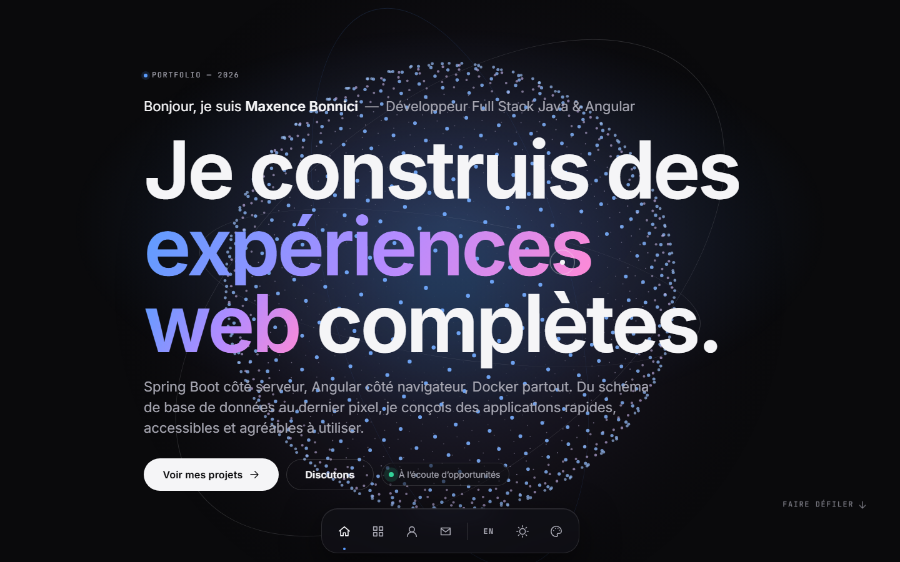
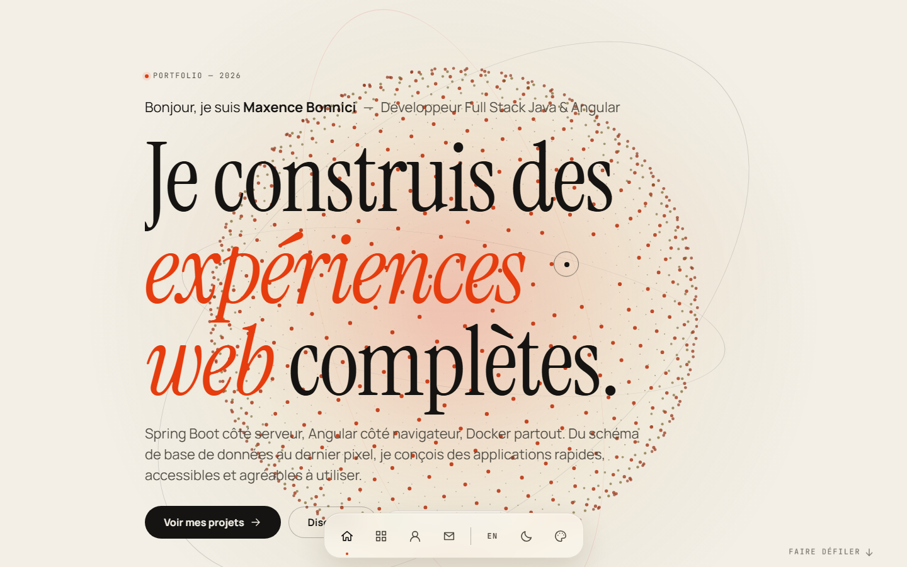
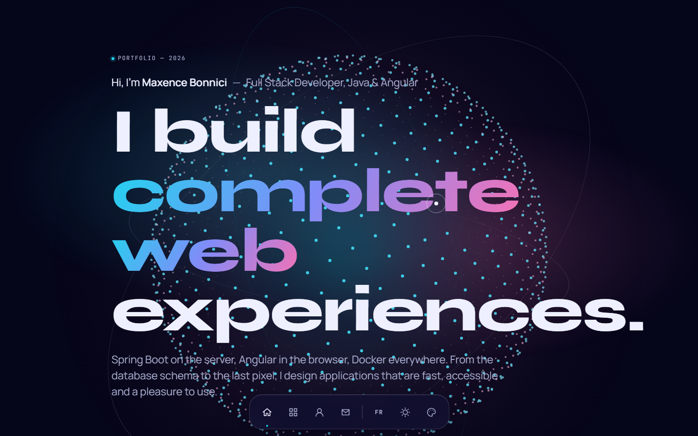
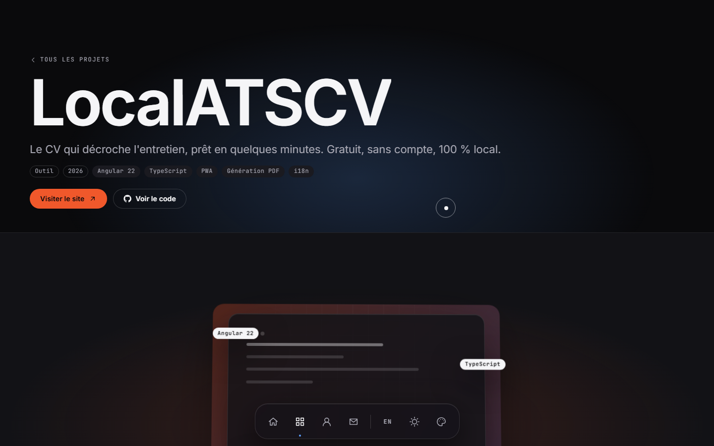
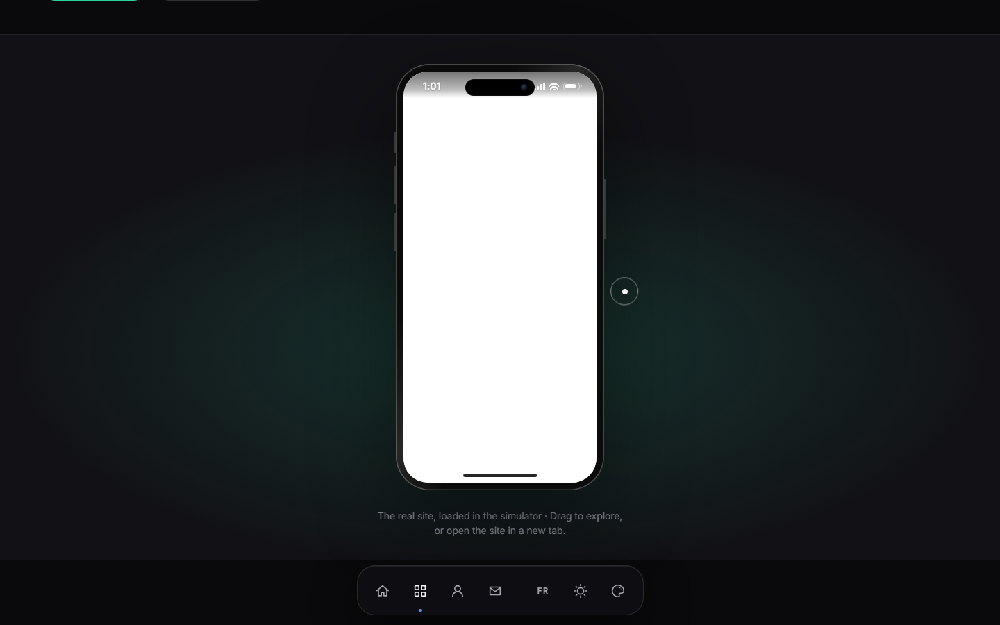
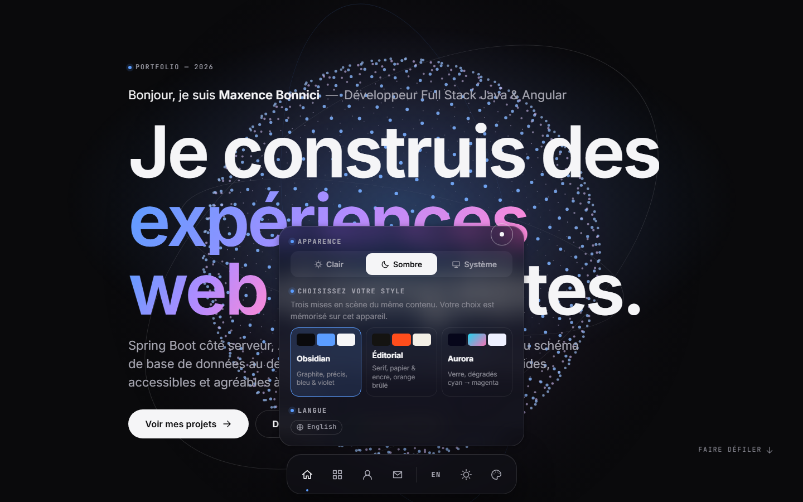
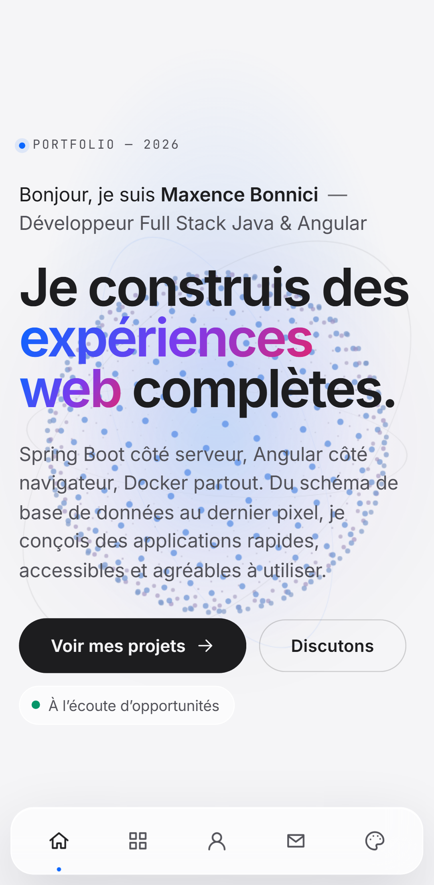

<div align="center">


# mbonnici.fr

### The portfolio of Maxence Bonnici, full stack developer (Java & Angular).

**Three visual styles · light & dark · French & English · interactive 3D scenes · back office**

[**mbonnici.fr**](https://mbonnici.fr) · [Changelog](CHANGELOG.md) · [Architecture](docs/ARCHITECTURE.md) · [Deployment](docs/DEPLOYMENT.md) · [Security audit](docs/SECURITY_AUDIT.md) · [Lighthouse](docs/LIGHTHOUSE.md)




</div>

---

## What it is

A personal site that behaves like a product: server-rendered pages for search engines and AI
assistants, a cinematic front end built without a single UI library, and a private back office
to publish projects, pictures and career updates without touching the code.

| Obsidian (dark) | Editorial (light) | Aurora (dark) |
| --- | --- | --- |
|  |  |  |

## Highlights

**Experience**
- **Three complete looks**, switchable from the dock: *Obsidian* (graphite, Apple-Pro precision),
  *Editorial* (serif, paper and ink, burnt orange) and *Aurora* (glass, cyan → magenta). Each one
  has its own light and dark scheme, fonts, radii and motion curves. The choice is remembered.
- **Native JavaScript physics**: magnetic cursor with a morphing ring, springs on every hover,
  macOS-style dock magnification, frame-rate-independent damping, no animation library.
- **Cinematic curtain transitions** between pages and masked word-by-word text reveals.
- **A 3D scene per project**, drawn on canvas or with CSS 3D: particle orb, orbit with floating
  stack labels, wireframe terrain with a pointer wake, double helix, layered glass stack.
- **iPhone Pro simulator** in pure CSS (titanium frame, Dynamic Island, live clock) that loads the
  real site in an iframe or a swipeable, momentum-driven screenshot carousel.
- **Floating frosted-glass dock** that becomes a tab bar on phones; thorough mobile layout.

| Project page — layered stack scene | Project page — iPhone simulator |
| --- | --- |
|  |  |

**Content & SEO**
- French and English with localised URLs (`/fr/projets/meowtrix`, `/en/projects/meowtrix`),
  hreflang alternates and a language switch that keeps you on the same page.
- Full server-side rendering with a per-request CSP nonce; JSON-LD (Person, WebSite, ItemList,
  SoftwareSourceCode, BreadcrumbList), Open Graph and Twitter cards, canonical links.
- Feeds for machines: `sitemap.xml`, `robots.txt` that welcomes AI crawlers, and
  [`llms.txt`](https://llmstxt.org) / `llms-full.txt` generated from the database.
- Legal notice, privacy policy and terms of use, in both languages, filled from the settings.

**Back office** (`/admin`, Google sign-in restricted to one e-mail address)
- Dashboard with page views, unique visitors, project views, outbound clicks, daily traffic
  chart, most viewed projects and pages, chosen styles / themes / languages / devices, referrers.
- Frontend and backend versions, build date and commit, Java and Spring Boot versions, database
  and storage health — all on one card.
- Projects: bilingual editor, scene picker with live previews, accent colour, media picker,
  publish / unpublish, drag-and-drop ordering. Media library with drag-and-drop upload and alt
  texts. Experience, education, skills, site settings and the contact inbox.
- **Backups**: one archive = the whole database (native `COPY` export) + every image. Download it,
  restore from a file, or link **Google Drive** (same account, `drive.file` scope only) for
  one-click and daily backups with retention, restore and offline download from any archive.
- **Server panel**: CPU, memory, Java heap, disk space left, database and media sizes, live.
- **Releases page** rendering this repository's changelog with the running version highlighted.

| Dock settings | Contact (Aurora, light) | Phone |
| --- | --- | --- |
|  |  |  |

**Privacy & security**
- Cookieless first-party analytics: a visitor is a daily-rotating salted hash, the IP is never
  stored, Do-Not-Track and Global Privacy Control are honoured, events are purged after 13 months.
  No consent banner needed.
- Google OIDC with an e-mail allow-list, HttpOnly/SameSite session cookie, CSRF double-submit,
  per-IP rate limiting, magic-byte upload validation, sandboxed media, strict security headers on
  both tiers. Details in [docs/SECURITY_AUDIT.md](docs/SECURITY_AUDIT.md).

**Accessibility**
- Skip link, keyboard-reachable dock and cards, focus rings, aria labels, live route
  announcements, `prefers-reduced-motion` (static scenes, no cursor, instant transitions),
  axe-core checks in the e2e suite.

## Stack

| Tier | Technology |
| --- | --- |
| Frontend | Angular 22 (zoneless, signals, SSR), Express, TypeScript, hand-written CSS with design tokens, self-hosted fonts |
| Backend | Spring Boot 4.1, Java 25, Spring Security (OAuth2 client), Spring Data JPA, Flyway, Bean Validation |
| Data | PostgreSQL 18, SeaweedFS (S3 API) for images — swappable for MinIO, Garage or Cloudflare R2 |
| Tests | 29 backend integration tests (Testcontainers), Playwright e2e on desktop and phone with axe-core |
| Ops | Docker Compose on [Coolify](https://coolify.io), Cloudflare in front, GitHub Actions CI |

## Repository

```
frontend/   Angular app, SSR server (src/server.ts), styles, e2e tests, scripts
backend/    Spring Boot API, Flyway migrations (src/main/resources/db/migration), tests
docs/       architecture, deployment, security audit, screenshots
docker-compose.yml        production stack (Coolify)
docker-compose.dev.yml    PostgreSQL + SeaweedFS for local development
docker-compose.local.yml  full stack on your machine
```

## Run it locally

Requirements: Node 24, a JDK 25 (Maven comes with `./mvnw`), Docker.

```bash
# 1. databases
docker compose -f docker-compose.dev.yml up -d --wait      # PostgreSQL :5433, SeaweedFS :8334

# 2. API
cd backend && ./mvnw spring-boot:run                        # http://localhost:8081

# 3. site
cd frontend && npm install && npm start                     # http://localhost:4200
```

The first start runs the migrations and seeds the projects, experience and skills; open
`/admin` to edit them (Google client needed, see [docs/DEPLOYMENT.md](docs/DEPLOYMENT.md)).

Full production-like stack:

```bash
cp .env.example .env     # fill the secrets
docker compose -f docker-compose.yml -f docker-compose.local.yml up --build
# http://localhost:4000
```

## Tests

```bash
cd backend  && ./mvnw verify            # integration tests on a throw-away PostgreSQL (Docker)
cd frontend && npm run build && npm run e2e   # Playwright: desktop + Pixel 7, axe accessibility
```

## Versions

Frontend and backend share one version (`frontend/package.json`, `backend/pom.xml`). The build
stamps the frontend with its version, commit and date (`scripts/version.mjs`); the backend
exposes its build info, Java and Spring Boot versions through `/api/admin/info`. Both appear on
the dashboard. Changes are tracked in [CHANGELOG.md](CHANGELOG.md).

## Licence

[MIT](LICENSE) — the code is free to reuse; the texts, pictures and project screenshots belong
to their authors.
